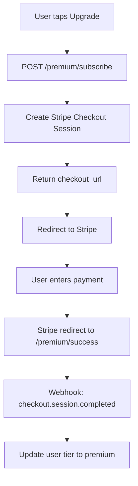

# Premium Model Recommendation

## Executive Summary

This document outlines a **Freemium Model** for SplitMate, balancing user acquisition with revenue generation. The recommendation focuses on a simple implementation that can evolve into more complex pricing as the user base grows.

---

## Recommended Pricing Strategy

### Tiers Overview

| Tier | Price | Target |
|------|-------|--------|
| **Free** | $0 | Casual users, try-before-buy |
| **Premium** | $2.99/month | Regular users who want full features |

**Initial Strategy**: Single premium tier with option to add more tiers later.

---

## Feature Comparison

### Free Tier Features

| Feature | Included | Notes |
|---------|----------|-------|
| Manual bill entry | ✅ | Unlimited |
| Photo capture (upload) | ✅ | Limited |
| Equal split | ✅ | Basic |
| Custom split | ❌ | Premium only |
| Percentage split | ❌ | Premium only |
| Bill history | 30 days | Auto-delete older |
| Share via link | ❌ | Premium only |
| Export PDF | ❌ | Premium only |
| Unlimited OCR | ✅ | Unlimited for all tiers |

### Premium Tier Features

| Feature | Included | Notes |
|---------|----------|-------|
| All free features | ✅ | |
| Unlimited OCR scans | ✅ | |
| Custom split | ✅ | Assign items to people |
| Percentage split | ✅ | Define % per person |
| Unlimited bill history | ✅ | Forever |
| Share via link | ✅ | Read-only access |
| Export to PDF | ✅ | Download receipt |
| Priority support | ✅ | Faster response |

---

## Usage Limits (Free Tier)

### OCR Scan Limit

```
Monthly Limit: 5 scans
Reset: 1st of each month
Tracking: Database table (usage_tracking)
```

### Implementation Check

```go
func (s *BillUsecase) CanProcessOCR(userID string) error {
    user, err := s.userRepo.GetByID(userID)
    if err != nil {
        return err
    }

    if user.Tier == "premium" {
        return nil // Unlimited
    }

    // Check usage for current month
    usage := s.usageRepo.GetMonthlyUsage(userID, time.Now().Month())
    if usage.OCRCount >= 5 {
        return ErrOCRLimitExceeded // Custom error
    }

    return nil
}
```

---

## Stripe Integration

### Products & Prices

```
Product: SplitMate Premium
Price: $2.99/month (price_id: price_premium_monthly)
```

### Checkout Flow



### API Endpoints

**POST /premium/subscribe**
```json
// Request
{
  "price_id": "price_premium_monthly"
}

// Response
{
  "checkout_url": "https://checkout.stripe.com/c/pay/...",
  "session_id": "cs_xxx"
}
```

**POST /premium/webhook** (no auth - Stripe signature verification)
```go
func HandleWebhook(req *http.Request) error {
    signature := req.Header.Get("Stripe-Signature")
    event, err := stripe.ConstructEvent(req.Body, signature, webhookSecret)

    switch event.Type {
    case "checkout.session.completed":
        // Activate premium
    case "customer.subscription.updated":
        // Handle plan changes
    case "customer.subscription.deleted":
        // Downgrade to free
    }
}
```

---

## Database Schema Changes

### New Table: users (add columns)

```sql
ALTER TABLE users ADD COLUMN tier ENUM('free', 'premium') DEFAULT 'free';
ALTER TABLE users ADD COLUMN stripe_customer_id VARCHAR(255);
ALTER TABLE users ADD COLUMN stripe_subscription_id VARCHAR(255);
ALTER TABLE users ADD COLUMN premium_expires_at TIMESTAMP;
```

### New Table: usage_tracking

```sql
CREATE TABLE usage_tracking (
    id UUID PRIMARY KEY DEFAULT gen_random_uuid(),
    user_id UUID REFERENCES users(id) ON DELETE CASCADE,
    action VARCHAR(50) NOT NULL,  -- 'ocr_scan'
    count INTEGER DEFAULT 1,
    month VARCHAR(7) NOT NULL,     -- '2024-01'
    created_at TIMESTAMP DEFAULT CURRENT_TIMESTAMP,
    UNIQUE(user_id, action, month)
);

CREATE INDEX idx_usage_tracking_user_month ON usage_tracking(user_id, month);
```

---

## Implementation Roadmap

### Phase 1: Basic Premium (MVP)

**Timeline**: 1-2 weeks

| Task | Description |
|------|-------------|
| Add tier to user model | Database migration |
| Implement usage tracking | Count OCR calls per user/month |
| Add premium check in API | Block custom/percentage split for free |
| Create upgrade UI | Simple "Upgrade to Premium" button |
| Stripe checkout | Basic subscription flow |
| Webhook handling | Activate premium on payment |

### Phase 2: Enhanced Premium

**Timeline**: 2-4 weeks (after user feedback)

| Task | Description |
|------|-------------|
| Share via link | Generate read-only bill URL |
| PDF export | Generate PDF receipt |
| Custom split UI | Full custom split interface |
| Email receipts | Send bill summary via email |

### Phase 3: Advanced (Future)

**Timeline**: Later, based on demand

| Feature | Description |
|---------|-------------|
| Family plan | $4.99/month for 4 users |
| Business tier | $9.99/month with team features |
| Export to CSV/Excel | Bulk data export |

---

## Revenue Projections

### Conservative Estimates

| Month | Users | Conversion | Monthly Revenue |
|-------|-------|-------------|------------------|
| 1 | 100 | 2% | $6 |
| 3 | 500 | 3% | $45 |
| 6 | 2,000 | 5% | $300 |
| 12 | 10,000 | 5% | $1,500 |

**Assumptions**:
- 5% conversion rate (typical for freemium)
- $2.99/month average revenue per user

---

## Implementation Details

### Checking Premium Status

```go
func (h *BillHandler) CreateBill(w http.ResponseWriter, r *http.Request) {
    userID := r.Context().Value("user_id").(string)

    // Get user from context (set by auth middleware)
    user, err := h.userUsecase.GetByID(userID)
    if err != nil {
        // Handle error
    }

    // Check if user can use custom features
    if req.SplitType == "custom" && user.Tier != "premium" {
        http.Error(w, "Custom split is a premium feature", http.StatusForbidden)
        return
    }
}
```

### Rate Limiting for Free Users

```go
func (s *OCRService) ProcessImage(ctx context.Context, userID string, image []byte) (*OCRResult, error) {
    user, _ := s.userRepo.GetByID(userID)

    if user.Tier == "free" {
        usage := s.usageRepo.GetMonthlyUsage(userID, time.Now())
        if usage.OCRCount >= 5 {
            return nil, ErrOCRLimitExceeded
        }
        // Increment counter
        s.usageRepo.IncrementUsage(userID, "ocr_scan")
    }

    return s.googleVision.ExtractItems(ctx, image)
}
```

---

## UI/UX Recommendations

### Upgrade Prompt Placement

1. **After 3rd OCR scan** - Banner: "You've used 3/5 free scans"
2. **On trying custom split** - Modal: "Premium feature"
3. **In settings** - Badge showing current tier

### Upgrade Modal Design

```
┌─────────────────────────────────────────┐
│  🏆 Upgrade to Premium                  │
│                                         │
│  Get unlimited access to:              │
│                                         │
│  ✓ Unlimited OCR scans                 │
│  ✓ Custom item assignment              │
│  ✓ Percentage-based splitting          │
│  ✓ Unlimited bill history             │
│  ✓ Share bills via link                │
│  ✓ Export to PDF                       │
│                                         │
│  ─────────────────────────             │
│  $2.99/month                           │
│                                         │
│  [Start Free Trial]  [Subscribe Now]   │
│                                         │
│  Cancel anytime. No commitment.        │
└─────────────────────────────────────────┘
```

---

## Risk Mitigation

| Risk | Mitigation |
|------|------------|
| Users creating multiple accounts | Device fingerprinting, email verification |
| Stripe webhook failures | Retry queue, manual reconciliation |
| Conversion too low | A/B test pricing, improve onboarding |
| Churn too high | Win-back emails, feedback collection |

---

## Success Metrics

| Metric | Target |
|--------|--------|
| Monthly Active Users | 1,000+ |
| Free to Premium Conversion | 3-5% |
| Monthly Recurring Revenue | $500+ by month 6 |
| Churn Rate | < 5%/month |
| NPS Score | 40+ |

---

## Conclusion

Starting with a simple **$2.99/month Premium tier** provides:
- Clear value proposition
- Easy to implement and maintain
- Room to add more tiers later
- Predictable revenue model

This approach allows you to **validate the market** before investing in complex pricing strategies. Start simple, gather user feedback, then expand based on demand.

---

## Next Steps

1. Create database migration for tier column
2. Implement usage tracking for OCR
3. Add premium feature gates in API
4. Set up Stripe account and products
5. Build upgrade UI in frontend
6. Test payment flow end-to-end